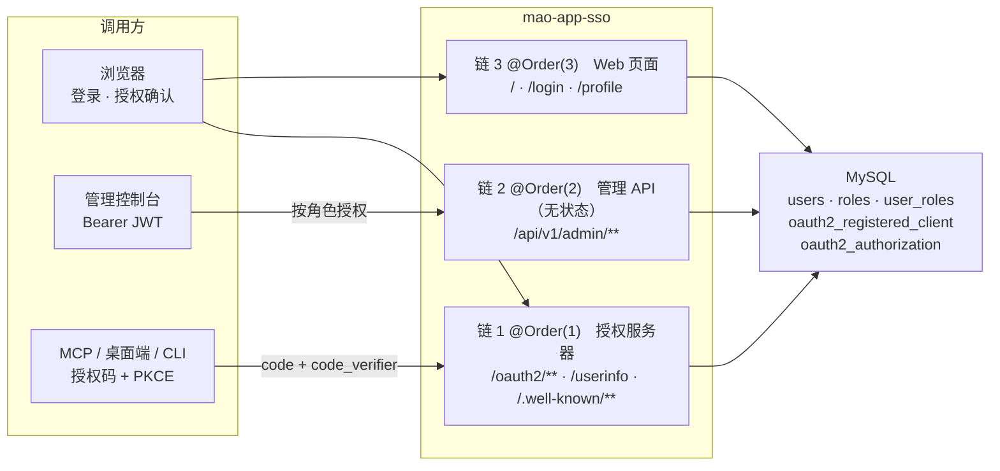

<div style="text-align: center">

# mao-app-sso

**OAuth 2.1 / OpenID Connect 1.0 统一认证中心**

一个登录入口，为多个业务系统签发 JWT；同时把用户、角色与 OAuth 客户端的管理能力暴露为 API。


[快速开始](#快速开始) · [技术栈](#技术栈) · [管理 API](#管理-api) · [生产部署](#生产部署) · [常见问题](#常见问题)

</div>

---

## 这个项目是什么

自托管的单点登录服务。业务系统不再各自维护账号，而是把登录交给本服务，拿回一个 RS256 签名的
JWT；客户端既可以是浏览器应用，也可以是 MCP 工具、桌面端、CLI 这类**没有会话、只能走授权码 + PKCE**
的程序。

**适合**：内网 / 私有化部署的统一登录；需要给 AI 工具（MCP）授权的中小系统；想读一份完整、可运行的
Spring Authorization Server 实现。

**不适合**：需要 SAML、社交登录、多租户或按 scope 做细粒度授权的场景——本项目的接口授权一律按**角色**。

---

## 功能特性

| 能力 | 说明 |
| --- | --- |
| 授权码模式 | `/oauth2/authorize` + `/oauth2/token`，强制 PKCE（仅接受 `S256`） |
| Refresh Token | 默认轮换（`reuseRefreshTokens=false`），旧令牌自动失效 |
| 公共客户端静默续期 | 官方实现对 `none` 认证方式不发 refresh token，本项目用自定义三件套补齐 |
| OpenID Connect 1.0 | `/.well-known/openid-configuration`、ID Token、`/userinfo` |
| JWT Access Token | RS256，`/oauth2/jwks` 公开公钥，claims 最小化（`sub`/`iat`/`exp`/`roles`） |
| OAuth Discovery | `/.well-known/oauth-authorization-server`（RFC 8414），补齐 `scopes_supported` 与 `none` |
| 动态客户端注册 | RFC 7591 `/oauth2/register`：按回调地址**反查**已录入客户端，只读、不下发 secret |
| 用户体系 | 用户名或邮箱登录、Argon2id、启用/锁定/密码过期、角色 `admin` / `customer` |
| 客户端持久化 | SAS 官方 JDBC 实现，密钥哈希存储，支持 public / confidential |
| 管理 API | `/api/v1/admin/**` 资源服务器形态（Bearer + 角色），无状态、不认 Cookie |
| 统一响应信封 | 成功 `{code:0,message,data}`，失败 `{code:1xxxx,message}`，HTTP status 按语义映射 |
| 错误页分流 | API 返回 JSON 信封；页面按 `4xx` / `5xx` 渲染不同模板；认证失败区分跳登录与返回 401 |
| 开箱可用 | V1 预置管理客户端 `mao-app-admin`，V2 预置角色与管理员，零手工 SQL |
| 安全加固 | 三条独立过滤链、CSRF、CORS 默认拒绝、CSP/Frame-Options、防用户枚举、防开放重定向 |

---

## 技术栈

| 组件 | 版本 | 说明 |
| --- | --- | --- |
| JDK | 25 | `maven.compiler.release=25` |
| Spring Boot | 4.1.2 | 父 POM 管理全部依赖版本 |
| Spring Security | 7.1.2 | 由 Boot BOM 管理 |
| Spring Authorization Server | 7.1.2 | `OAuth2AuthorizationServerConfigurer` 已并入 spring-security-config |
| MyBatis | starter 4.1.0 | 不在 Boot BOM 内，需显式声明版本；SQL 外置 XML |
| Flyway | 12.4.0 | 自动配置位于独立模块 `spring-boot-flyway` |
| Thymeleaf | 3.1.5 | 仅登录 / 首页 / 资料 / 授权确认 / 错误页 |
| MySQL Connector/J | 9.x | |
| BouncyCastle | 1.86 | `Argon2PasswordEncoder` 依赖 |
| Lombok | 1.18.48 | `provided` |

---

## 架构



三条过滤链**互不共享认证方式**，这是本项目的核心安全边界：

| 链 | 顺序 | 匹配范围 | 认证方式 | 状态 |
| --- | --- | --- | --- | --- |
| 授权服务器 | `@Order(1)` | `/oauth2/**`、`/userinfo`、`/.well-known/**` | Session（仅浏览器导航跳登录） + 客户端认证 | 按需 |
| 管理 API | `@Order(2)` | `/api/v1/admin/**` | **只认 Bearer JWT** | `STATELESS`，关 CSRF |
| Web | `@Order(3)` | 其余（页面） | Session（表单登录） | 有状态，CSRF 开启 |

拿到管理角色的 Token 也无法借 Cookie 越权，反过来浏览器会话也调不动管理 API。

### 代码结构

包按**对外入口**切分，看包名就知道属于认证服务器还是管理 API：

| 包 | 职责 |
| --- | --- |
| `auth` | 认证服务器：协议端点（`/oauth2/**`、`/userinfo`、`/.well-known/**`）、DCR、令牌定制、登录与门户页面 |
| `api` | 资源服务器：`/api/v1/admin/**`（控制器、DTO、JWT 解码、响应信封） |
| `domain` | 账号与客户端服务、错误码、分页与审计 —— 被上面两者共用，自己**不依赖**它们 |
| `tools` | 命令行工具：`JwkGenerator`、`CertificateConverter` |

依赖只允许单向流动（`auth` / `api` → `domain`），`auth` 与 `api` 互不引用。这条边界由
`ArchitectureTest`（ArchUnit）在构建期强制，误加一个 import 就会构建失败。

---

## 快速开始

### 准备环境

| 依赖 | 要求 |
| --- | --- |
| JDK | **25**（`maven.compiler.release=25`，低于 25 编译不过） |
| Maven | 3.9+（仓库自带 `mvnw`） |
| MySQL | 8.0+ |

数据库要求：

- 已存在一个空库（默认 `mao_sso`），服务器字符集 `utf8mb4` / `utf8mb4_unicode_ci`；
- 账号至少具备该库的 `CREATE`、`ALTER`、`INDEX`、`INSERT` 权限——**建表不需要手工执行 SQL**，
  表结构全部由 Flyway 在首次启动时建立；
- 生产要求 TLS（`sslMode: VERIFY_CA`，客户端 truststore 需装有签发服务器证书的 CA）；
  本地开发可以关闭，见下一步。

### 更改配置

`src/main/resources/application.yml` 是唯一的配置文件，写的就是本地基线值。本地跑起来需要确认三处：

| 配置项 | 基线 | 要做什么 |
| --- | --- | --- |
| `spring.datasource.url` / `username` / `password` | `localhost:3306/mao_sso`、`root` / `root` | 改成你的库 |
| `...hikari.data-source-properties.sslMode` | `VERIFY_CA` | 本地库是自签证书时改成 `DISABLED`，并把 `allowPublicKeyRetrieval` 置 `true` |
| `sso.jwk.location` | `file:D:/certs/sso-jwk/jwk-set.json` | 指向下一步生成的密钥文件 |

**签名密钥**（仓库不含私钥）：运行 `com.mao.sso.tools.JwkGenerator` 的 `main` 方法（**无参数**）即可，
它会把 JWK Set 写到 `D:/certs/sso-jwk/jwk-set.json`，与 `sso.jwk.location` 的默认值一致。要换位置就
同时改 `JwkGenerator.OUTPUT_DIR` 常量与 yml 里的 `location`。

两点必须知道：

- `location` 一旦有值就**一定**会去加载，文件缺失时启动直接失败，不会回退到临时密钥；
- 生成逻辑是「先删旧文件再写」，重复执行等于换钥。

> 生产环境不要动这份文件，用外挂 `config/application.yml` 覆盖差异项，见[生产部署](#生产部署)。

### 启动

```bash
./mvnw spring-boot:run
```

访问 <http://127.0.0.1:8080/>，用 `admin` / `Admin@123456` 登录。

> **注意 `127.0.0.1` 与 `localhost` 的区别**：`sso.issuer-url` 默认是 `http://127.0.0.1:8080`。
> RFC 8414 要求发现元数据里的 `issuer` 与客户端使用的标识**逐字符相等**，用 `localhost`
> 访问会拿到 `issuer=127.0.0.1` 的元数据，严格客户端会直接放弃。

### 一分钟验证

```bash
curl -s http://127.0.0.1:8080/.well-known/openid-configuration   # 发现元数据
curl -s http://127.0.0.1:8080/oauth2/jwks                        # 公钥（不含私钥参数）
```

### 初始账号

V2 迁移预置 `admin` / `Admin@123456`，并置 `must_change_password = true`。
启动时若 `sso.admin.password` 有值且该标记仍为 `true`，会用配置值**覆盖一次**并清除标记。

所以当前基线（`password: Admin@123456`）的行为是：**登录不会强制改密**。
生产环境请把该值改成强密码，或把它留空以保留「首次登录必须改密」的强制流程。

初始密码在任何日志与接口里都不会回显，库里只有 Argon2id 哈希。

---

## 管理 API

形态是**资源服务器**：控制台先走授权码 + PKCE 登录本服务拿到 Access Token，
再以 `Authorization: Bearer <token>` 调用。管理链完全无状态，不认 Cookie。

| 模块 | 前缀 | 能力 |
| --- | --- | --- |
| 用户 | `/api/v1/admin/user` | 分页、详情、创建、更新、修改密码、重置密码、续期、锁定/解锁、启用/禁用、绑定角色、删除 |
| 客户端 | `/api/v1/admin/client` | 分页、详情、创建、更新、删除 |

| 约定 | 说明 |
| --- | --- |
| 方法 / 请求体 | 全部 `POST`，`application/json` |
| 鉴权 | JWT 的 `roles` claim 需含 `sso.admin-api.required-role`（默认 `ADMIN`）；scope 不参与授权 |
| 分页入参 | `pageNum`（从 1 起）、`pageSize`、`recount`（默认 `true`）、`lastHitCount` |
| 一次性明文 | 创建用户 / 重置密码 / 创建保密客户端时，明文只在当次响应返回 |

### 响应信封与错误码

| 场景 | HTTP | body |
| --- | --- | --- |
| 成功 | 200 | `{code: 0, message: "ok", data: {...}}` |
| 业务错误 | 按 `ErrorCode` 映射 | `{code: 1xxxx, message: "..."}`，无 `data` 字段 |
| 系统错误 | 500 | `{code: 50000, message: "服务器内部错误"}`（不泄露细节） |

错误码定义在 `domain/error/ErrorCode.java`（码 + HTTP status + 默认文案绑定一处）：

| code | HTTP | 含义 |
| --- | --- | --- |
| `0` | 200 | 成功 |
| `10000` | 400 | 请求参数不合法（DTO 校验失败、JSON 格式错、`redirect_uri` 非法） |
| `10001` | 404 | 资源不存在 |
| `10002` | 409 | 资源重复（client_id / 用户名 / 回调地址已存在） |
| `10003` | 409 | 操作不被允许（删自身客户端、删最后一个管理员） |
| `10401` | 401 | 未认证（Web 链非 HTML 请求） |
| `10403` | 403 | 无权限 |
| `10404` | 404 | 地址不存在（无匹配路由、静态资源未命中） |
| `10405` / `10415` | 405 / 415 | 方法 / 内容类型不支持 |
| `50000` | 500 | 未分类异常兜底 |

两条刻意的决策：

- **HTTP status 能映射就用**（400/401/403/404/405/409/415），映射不上才用 500；调用方以 body 的 `code` 为准。
- **管理链的 401/403 保持 RFC 6750**（`WWW-Authenticate` 头），**不套信封**——OAuth 客户端生态依赖标准格式。

---

## OAuth 客户端管理

所有客户端必须先通过 `/api/v1/admin/client/create` 录入：填 client_id、client_name、认证方式、
授权类型、回调地址、scope 等，之后才可能被授权。保密客户端支持重新生成密钥；删除即物理删除。

### 约定：一个客户端只允许一个 redirect_uri

硬约定，根源是 DCR 靠回调地址**反查**客户端。回调一旦有歧义，反查可能返回**另一个**客户端，
而请求方完全无法察觉自己拿错了身份。

落地四层，缺一层就能被绕过：

| 层 | 做法 |
| --- | --- |
| API 契约 | `/create`、`/update` 的回调字段是**单值** `redirectUri`；`/create` 必填，`/update` 留空表示不改 |
| 服务层 | 拒绝空白值、通配符、非绝对 URI，并**显式拒绝含逗号的地址** |
| 全局唯一 | 写入时检查是否已被其它客户端占用（`DuplicateResourceException` → 409），更新时自身原地址不算冲突 |
| 存储层 | `/update` 走 `clear()` 后写入，是**替换**而非追加 |

> 为什么必须拒绝逗号：`oauth2_registered_client.redirect_uris` 是 SAS 官方 schema 的 `varchar`，
> 按逗号切分反序列化。`https://a.com/cb?x=1,2` 写进去会变成两条回调，等于从存储层绕过约定。

冲突判定复用 `findByExactRedirectUri` 的同一套匹配规则，而不是另写 SQL——两处各自实现会出现
「写入判定不冲突、运行时反查命中另一个客户端」的不一致。

**为什么不用数据库唯一约束**：该列是逗号分隔的 `varchar`，加不了唯一索引；拆表又会破坏
`JdbcRegisteredClientRepository` 的兼容性。已知局限：并发创建同一回调存在理论窗口期，
客户端录入是低频人工操作，暂不加锁。

读接口仍返回数组 `redirectUris`，这是对存储状态的忠实映射：正常恒为 1 个元素，出现多条只可能
来自手工 INSERT 的历史数据，前端能直接看到并清理。

---

## 动态客户端注册（DCR）

`/oauth2/register`（RFC 7591）让 MCP 这类客户端在运行时按回调地址自取 `client_id`。

**它不是标准 DCR，而是「按回调地址反查」的只读接口**——这是理解本项目的关键：

| | 标准 RFC 7591 | 本项目 |
| --- | --- | --- |
| 未登记的回调 | 建新客户端 | 400 `invalid_redirect_uri` |
| 写库 | `INSERT` | **不写** |
| client_id | 新分配 | 返回**预录入**的那个 |
| client_secret | 下发 | **永不下发** |
| 重复调用 | 建出多个客户端 | 幂等，永远同一个 id |
| 后续管理接口 | 有 | 无 |

```bash
curl -i http://127.0.0.1:8080/oauth2/register \
  -H 'Content-Type: application/json' \
  -d '{"client_name":"我的MCP客户端",
       "redirect_uris":["workbuddy://workbuddy/mcp/my-connector/oauth/callback"],
       "grant_types":["authorization_code","refresh_token"],
       "token_endpoint_auth_method":"none"}'
# 已预录入 → 201 {client_id: "<预录入的 client_id>", ...}
# 未预录入 → 400 invalid_redirect_uri
```

端点启用后**匿名可调**，这是由其消费方决定的（MCP / CLI / 桌面端没有会话，也不持有 Bearer）。
想限制来源请放在网络层：网关、内网、IP 白名单。护栏是「回调必须预录入」+ 每 IP 限流。

`sso.dcr.enabled` 的生产取值只有一个判断标准——**客户端能不能把 `client_id` 离线写进配置？**

- 能（自家前端、固定工具）→ `false`，少一个对外端点；
- 不能（要发给第三方，或安装时才确定地址）→ `true`。

限流键已适配反向代理：直连时只认对端地址（不信任转发头，防伪造绕过）；对端为回环/内网时，
从 `X-Forwarded-For` **右往左**取第一个公网地址（`X-Real-IP` 兜底），与 Tomcat `RemoteIpValve`
的算法一致。

> OIDC 版注册端点 `/connect/register` 未启用：SAS 的实现强制校验 initial access token，
> 无法匿名开放，暴露它只会得到一个必然失败的端点。

---

## 发现元数据与 MCP 接入

SAS 默认不宣告 `scopes_supported`，也不把 `none` 放进 `token_endpoint_auth_methods_supported`。
而 MCP / 桌面 / 移动端几乎都是 public client，且要靠元数据决定请求哪些 scope——缺这两项，
严格客户端会在进入注册之前就放弃。`sso.metadata` 段用于补齐。

> 实现注记：定制挂在 `authorizationServerMetadataEndpoint`（RFC 8414）上，所以
> `/.well-known/oauth-authorization-server` 会宣告 `scopes_supported` 与 `none`；
> OIDC 的 `/.well-known/openid-configuration` 仍走 SAS 默认值（`scopes_supported: ["openid"]`）。
> MCP 使用的是前者，不受影响；纯 OIDC 客户端若依赖后者决定 scope，请知悉这一差异。

```text
MCP 客户端 ──GET /mcp───────────────────────────────► MCP 服务器
           ◄──401 + WWW-Authenticate────────────────
MCP 客户端 ──GET /.well-known/oauth-protected-resource─► MCP 服务器
           ◄──{resource, authorization_servers:[...], scopes_supported}──
MCP 客户端 ──GET /.well-known/oauth-authorization-server─► SSO　（必须匿名可读）
           ◄──{issuer, registration_endpoint, scopes_supported, ...}──
MCP 客户端 ──POST /oauth2/register──────────────────► SSO（public client + PKCE）
           ◄──201 {client_id}───────────────────────
浏览器     ──GET /oauth2/authorize?...&resource=...──► SSO → /login → /oauth2/consent
           ◄──302 redirect_uri?code=...&state=...────
MCP 客户端 ──POST /oauth2/token（code + code_verifier）─► SSO
           ◄──200 {access_token, refresh_token}──────
MCP 客户端 ──GET /mcp + Authorization: Bearer ...───► MCP 服务器
```

接入时必须对齐三处：

1. **issuer 逐字符相等**。资源服务器宣告 `authorization_servers: ["http://127.0.0.1:8080"]`，
   `sso.issuer-url` 就不能是 `http://localhost:8080`。
2. **元数据要宣告 `none` 与 `scopes_supported`**（`sso.metadata.*`，默认已开）。
3. **回调地址必须已通过管理 API 预录入**（DCR 是精确匹配查表，没有正则白名单）。
   自定义协议（如 `workbuddy://workbuddy/mcp/.../oauth/callback`）可以录入，只需是绝对 URI、
   不含通配符与逗号。

> 已知边界：SAS 7.1 未实现 RFC 8707（Resource Indicators），授权请求里的 `resource` 参数会被
> 静默忽略，Access Token 的 `aud` 是 **client_id** 而不是资源服务器地址。若要按 `aud` 校验，
> 需自行用 `OAuth2TokenCustomizer<JwtEncodingContext>` 写入。

### 自定义协议重定向中间页（桌面客户端必读）

Chromium 内核（Edge / Chrome）对**表单 POST 后 302 跳到自定义协议**会**静默丢弃**——不弹窗、
不跳转、不报错，表现为「点了同意授权页面毫无反应」（授权码其实已签发）。

因此授权响应要跳到非 `http(s)` 协议时，本项目不直接 302，而是渲染一个中间页
（`auth/filter/CustomSchemeRedirectFilter`），页内给出指向该地址的普通链接，用户点击后浏览器才会
唤起系统的「打开应用」弹窗。

- 只拦截 **POST** 产生的重定向；GET 直达授权端点的 302 保持原样（该路径验证可用）。
- 中间页不含内联脚本/样式，符合本站 CSP；同时展示可复制的完整回跳地址。
- 本地联调可用 `docs/tools/e2e-mcp-flow.py` 跑完整链路
  「DCR → 授权码 + PKCE → 登录 → 授权确认 → 中间页 → 换 Token → refresh 续期」并打印 claims。
  跑之前先把脚本顶部的 `BASE` / `REDIRECT` / `SCOPES` 对齐到你实际预录入的那个客户端。

---

## 授权码流程

浏览器侧：

1. 打开授权 URL → 未登录跳 `/login` → 登录后自动回到授权端点；
2. 首次授权该客户端会展示**授权确认页**（仅请求 `openid` 单个 scope 时 SAS 会跳过，直接发码）；
3. 同意 → 302 到 `redirect_uri?code=...&state=...`；自定义协议则先渲染中间页；
4. 客户端用授权码 + `code_verifier` 换 Token；再次授权同范围不再弹确认页。
   退出登录走 `/logout` → 登出结果页。

授权 URL 示例（`code_challenge = base64url(sha256(code_verifier))`）：

```text
http://127.0.0.1:8080/oauth2/authorize?response_type=code&client_id=mao-app-admin
  &scope=openid%20profile
  &redirect_uri=http%3A%2F%2Flocalhost%3A5173%2Fcallback
  &state=xyz&code_challenge=E9Melhoa2OwvFrEMTJguCHaoeK1t8URWbuGJSstw-cM&code_challenge_method=S256
```

无浏览器参与的服务端流程（用 cookie jar 维护会话）。示例直接用 V1 预置的公共客户端
`mao-app-admin`，因此**不需要客户端密钥**：

```bash
BASE=http://127.0.0.1:8080
CLIENT_ID=mao-app-admin                       # V1 预置的 public client（none + 强制 PKCE）
REDIRECT_URI=http://localhost:5173/callback   # 它唯一登记的回调地址
CODE_VERIFIER=$(openssl rand -base64 48 | tr '+/' '-_' | tr -d '=\n')
CODE_CHALLENGE=$(printf %s "$CODE_VERIFIER" | openssl dgst -sha256 -binary | base64 | tr '+/' '-_' | tr -d '=\n')
STATE=$(uuidgen)

# 1) 授权请求（未登录 → 302 到 /login）
curl -i -c jar.txt "$BASE/oauth2/authorize?response_type=code&client_id=$CLIENT_ID&scope=openid%20profile\
&redirect_uri=$REDIRECT_URI&state=$STATE&code_challenge=$CODE_CHALLENGE&code_challenge_method=S256"

# 2) 登录（从登录页 HTML 提取 _csrf）
CSRF=$(curl -s -c jar.txt "$BASE/login" | grep -oP 'name="_csrf" value="\K[^"]+')
curl -i -b jar.txt -c jar.txt -X POST "$BASE/login" \
  -d "username=admin&password=Admin@123456&_csrf=$CSRF"

# 3) 再次授权（首次需要确认 → 302 到 /oauth2/consent，记下 Location 里的 state）
curl -i -b jar.txt -c jar.txt "$BASE/oauth2/authorize?response_type=code&client_id=$CLIENT_ID&scope=openid%20profile\
&redirect_uri=$REDIRECT_URI&state=$STATE&code_challenge=$CODE_CHALLENGE&code_challenge_method=S256"

# 4) 提交确认
CONSENT_STATE=<上一步 302 Location 中的 state>
CSRF2=$(curl -s -b jar.txt "$BASE/oauth2/consent?client_id=$CLIENT_ID&scope=openid%20profile&state=$CONSENT_STATE" \
  | grep -oP 'name="_csrf" value="\K[^"]+')
LOCATION=$(curl -s -o /dev/null -w '%{redirect_url}' -b jar.txt -X POST "$BASE/oauth2/authorize" \
  -d "client_id=$CLIENT_ID&state=$CONSENT_STATE&scope=openid&scope=profile&_csrf=$CSRF2")
CODE=$(printf %s "$LOCATION" | grep -oP 'code=\K[^&]+')

# 5) 换 Token（公共客户端把 client_id 放在 body 里，不用 -u）
TOKEN_JSON=$(curl -s -X POST "$BASE/oauth2/token" \
  -d "grant_type=authorization_code&client_id=$CLIENT_ID&code=$CODE\
&redirect_uri=$REDIRECT_URI&code_verifier=$CODE_VERIFIER")
ACCESS_TOKEN=$(printf %s "$TOKEN_JSON" | grep -oP '"access_token":"\K[^"]+')
REFRESH_TOKEN=$(printf %s "$TOKEN_JSON" | grep -oP '"refresh_token":"\K[^"]+')

# 6) UserInfo / 7) Refresh 轮换 / 8) 发现与 JWKS
curl -s "$BASE/userinfo" -H "Authorization: Bearer $ACCESS_TOKEN"
curl -s -X POST "$BASE/oauth2/token" \
  -d "grant_type=refresh_token&client_id=$CLIENT_ID&refresh_token=$REFRESH_TOKEN"
curl -s "$BASE/.well-known/oauth-authorization-server"
```

> 保密客户端（`client_secret_basic`）则把上一步换成 `-u "$CLIENT_ID:$CLIENT_SECRET"`，
> body 里去掉 `client_id`。

> `/oauth2/authorize` 的 POST（授权确认）由 `state` 提供 CSRF 防护（RFC 6749 要求），安全链对该端点
> 豁免 CSRF；登录、资料修改、管理操作等表单均需 CSRF Token。

---

## 数据库设计

Flyway 版本化迁移（`src/main/resources/db/migration`），**只有两个脚本**：

| 脚本 | 内容 |
| --- | --- |
| `V1__oauth2_client_schema.sql` | `oauth2_registered_client` / `oauth2_authorization` / `oauth2_authorization_consent` 三张官方表 + 客户端审计列与唯一索引；**并插入默认客户端 `mao-app-admin`** |
| `V2__user_role_schema.sql` | `users` / `roles` / `user_roles`；**并插入角色 `admin`、`customer` 与管理员 `admin`** |

| 表 | 来源 | 说明 |
| --- | --- | --- |
| `users` | 自建 | 密码哈希、启用/锁定、`credentials_expired_at`、`must_change_password`、`last_login_at`、`phone`/`avatar`、审计字段 |
| `roles` | 自建 | 角色（`code` 即业务标识：`admin` / `customer`） |
| `user_roles` | 自建 | 用户-角色多对多，外键级联删除 |
| `oauth2_registered_client` | [官方 schema](https://docs.spring.io/spring-authorization-server/reference/core/configuration/jpa.html) | 客户端 + `client_id` 唯一索引 + 审计字段 |
| `oauth2_authorization` | 官方 schema | 授权记录（授权码 / Token / 元数据） + 2 个查询索引 |
| `oauth2_authorization_consent` | 官方 schema | 授权同意记录 |

设计要点：

- 密码过期用 **`credentials_expired_at`（NULL = 永不过期）** 单一真相，不设布尔列，
  是否过期由 `User#isCredentialsExpired()` 按当前时间派生；
- **角色 code 全小写**，Security 侧统一映射为 `ROLE_<大写>`：`hasRole("ADMIN")` 与
  `hasAuthority("ROLE_ADMIN")` 都成立；
- 时间统一 `TIMESTAMP(6)`、UTC 存取（连接参数 `preserveInstants=true&connectionTimeZone=UTC`）；
- 审计字段由应用层写入（`AuditContext` 取当前登录用户名），不使用 JPA Auditing；
- 不保存明文密码与明文客户端密钥。

> ⚠️ **`oauth2_registered_client` 的列格式有坑**：`client_authentication_methods` /
> `authorization_grant_types` / `redirect_uris` / `scopes` 必须写成**逗号分隔**字符串（不是 JSON
> 数组）；只有 `client_settings` / `token_settings` 是 JSON，且**必须**带
> `"@class":"java.util.Collections$UnmodifiableMap"`。写错会抛
> `missing type id property '@class'` 或 `scope "..." contains invalid characters`。

---

## 生产部署

### 1. 签名密钥

必须使用持久化 JWK Set。`sso.jwk.allow-ephemeral` 置 `false`，未配置则启动失败——绝不允许生产
用临时密钥（重启后所有未过期 Token 全部验签失败）。

生成方式见[快速开始](#更改配置)。两条硬约束：

- **私钥文件不入库**：含全部 RSA CRT 参数，泄露即可伪造任意用户 Token；
- **`JwkGenerator` 不是轮换工具**：每次运行覆盖旧文件。真要平滑轮换，手工构造含新旧两把密钥
  （不同 `kid`）的 JWK Set，JWKS 端点会公开全部公钥，签名用第一个。

### 2. 外挂配置

仓库里只有一份 `application.yml`（本地基线，随 jar 打包）。生产**不改它**，而是在 jar 同级
`config/` 目录（或容器挂载 / K8s ConfigMap）放一份只含差异项的 `application.yml`：

```text
jar 内 application.yml  →  config/application.yml  →  环境变量 / 系统属性
        （基线）                （部署值）                  （应急覆盖）
```

- **按 key 逐项合并，不是整份替换**——外挂文件只写要改的项，没写的继续用基线值；
- 文件里没有 `${SSO_XXX:默认值}` 占位符，值就是值。应急可用 Spring 标准变量名覆盖
  （`SPRING_DATASOURCE_URL`、`LOGGING_LEVEL_ROOT`），自定义别名已不存在；
- `application.yml` 末尾附了一段**注释掉的生产覆盖清单**，逐 key 列出该填什么，复制出来取消注释即可用；
  各配置项旁也有 `【生产】` 标注。

```yaml
spring:
  datasource:
    url: jdbc:mysql://db.prod:3306/mao_sso
    username: sso_app
    password: <密码>
    hikari:
      data-source-properties:
        sslMode: VERIFY_CA              # 有稳定域名且证书 SAN 覆盖它时可升 VERIFY_IDENTITY
        allowPublicKeyRetrieval: false
        trustCertificateKeyStoreUrl: file:/etc/sso/mysql/truststore.p12
        trustCertificateKeyStorePassword: <密码>
  thymeleaf:
    cache: true
server:
  servlet:
    session:
      cookie:
        secure: true
sso:
  issuer-url: https://sso.example.com
  hsts-enabled: true
  jwk: { location: file:/etc/sso/jwk-set.json, allow-ephemeral: false }
  admin:
    password: <改掉初始密码>
  dcr:
    enabled: false
  metadata: { cors-allowed-origins: https://console.example.com }
  admin-api: { cors-allowed-origins: https://console.example.com }
logging:
  level:
    root: WARN
    com.mao.sso: INFO
    com.mysql.cj.protocol: INFO
```

容器与 K8s 同理：挂载到 `config/application.yml` 或做成 ConfigMap，不需要改镜像。

### 3. 其他必做项

- **Issuer**：`sso.issuer-url` 必须是浏览器可达的 HTTPS 地址，与反向代理对外地址逐字符一致；
- **HTTPS**：TLS 终止在代理（Nginx / ALB），应用层开启 `cookie.secure` 与 `hsts-enabled`；
- **数据库**：独立账号 + 最小权限；定期备份 `oauth2_authorization`（含未过期 Token）；
- **数据库 TLS**：证书同样不入库。`truststore.p12` / `client-keystore.p12` 由
  `CertificateConverter` 从 pem 转换，双向认证仅在服务器端 `REQUIRE X509` 时才需要 client-keystore；
- **`oauth2_authorization` 索引**：Token 查询的部分条件是全表扫描，高并发场景可按需补
  `authorization_code_value` / `access_token_value` 前缀索引；
- **日志脱敏**：应用日志不输出密码、Token、客户端密钥；`spring.web.error.include-*` 全部为 `never`。

---

## 安全设计

- **按角色授权，不按 scope**：管理链从 JWT 的 `roles` claim 派生 `ROLE_*`，要求 `ROLE_ADMIN`。
  scope 只有 `openid`/`profile`，仅用于裁剪 OIDC claims。
- **PKCE**：框架仅接受 `S256`，客户端可配 `requireProofKey` 强制。
- **密码**：Argon2id（m=19MiB, t=2, p=1, salt=16B, hash=32B）；客户端密钥同样哈希后持久化。
- **Session**：`SSO_SESSION`（HttpOnly、SameSite=Lax、生产加 Secure）、30 分钟超时、
  `changeSessionId` 防会话固定（保留授权请求状态）。
- **防用户枚举**：登录失败统一提示「用户名或密码错误」，不区分不存在 / 禁用 / 锁定（详情只进日志）。
- **防开放重定向**：登录成功只跳站内相对地址；授权端点对非法 `redirect_uri` 不执行重定向。
- **CORS 默认拒绝**：除发现 / JWKS / 注册 / userinfo 外一律 403；同源请求不受影响。
- **安全响应头**：CSP（`default-src 'self'`，无 `unsafe-inline`）、`X-Frame-Options: DENY`、
  `Referrer-Policy`、`nosniff`，生产加 HSTS。
- **Token claims 最小化**：Access Token 只有 `sub`/`iat`/`exp`/`roles`；ID Token 在 `profile`
  scope 下加 `name`/`preferred_username`；不含密码、邮箱。

### 错误处理分层

- **判定**：`RequestKindResolver` 是唯一入口（`/api/` 前缀 → API；Accept 明确 JSON → API；
  其余 → 页面）。异常链与 Web 安全链共用，OAuth 端点不经过（SAS 自理，保持 RFC 6749 错误格式）。
- **映射**：`ErrorCode` 把错误码、HTTP status、默认文案绑定在一处；`BusinessException` 必须携带它。
  服务层禁止抛裸 `IllegalArgumentException`（会落 500）。
- **呈现**：`ApiExceptionHandler`（`@RestController`，JSON 信封）→ `PageExceptionHandler`
  （`@Controller`，`error/4xx|5xx` 模板）→ `FrameworkExceptionHandler`（兜底框架 4xx 与未知异常）。
  成功响应由 `ApiResultWrapper` 统一加壳。
- **认证/授权失败在 Filter 层**（advice 管不到）：Web 链 HTML 未认证 → 302 `/login`，
  非 HTML → 401 JSON；无权限 HTML → `error/4xx` 模板，非 HTML → 403 JSON。授权服务器链保持
  「仅浏览器导航跳登录页，其余走 SAS 默认 401」——两条链的默认方向相反，不能共用一个判定器。

---

## 常见问题

**启动报 `JWK 资源不存在`？**
`sso.jwk.location` 有值就一定去加载，缺文件不会回退。生成密钥，或把 `location` 置空
（配合 `allow-ephemeral: true`）。

**启动报 `Schema validation: missing table`？**
确认 `spring.flyway.enabled=true` 且 `spring-boot-flyway` 依赖存在。表结构只由迁移管理，
项目已不使用 JPA，没有 `ddl-auto`。

**默认管理员是什么？**
`admin` / `Admin@123456`（V2 预置）。生产务必改 `sso.admin.password`，或留空以强制首次改密。

**换 Token 报 `invalid_grant`？**
授权码一次性且 5 分钟过期；`code_verifier` 必须与 `code_challenge` 匹配；`redirect_uri`
必须与授权请求完全一致。

**公共客户端为什么没有 refresh_token？**
官方实现不给 `none` 认证方式签发。本项目已用自定义三件套补齐；若仍拿不到，检查客户端的
`authorization_grant_types` 是否包含 `refresh_token`。

**改了 yml 里的客户端为什么不生效？**
客户端已全部改为「预录入 + 数据库为准」，没有 YAML 静态客户端。请调用
`POST /api/v1/admin/client/create`，或直接维护 `oauth2_registered_client` 表。

**管理接口返回 401 / 403？**
401 = 没有可用 Bearer Token（管理链不认 Cookie）；403 = Token 的 `roles` 里没有 `admin`。
改角色后必须**重新签发 Token**——`roles` 是签发时写进 JWT 的。

**用户创建后为什么看不到密码？**
初始密码与重置后的密码只在当次响应返回（`initialPassword`），库里只有哈希，丢失只能重置。

**角色管理接口在哪？**
`/api/v1/admin/role/**` 尚未实现。角色由迁移预置，经用户接口 `/bind-roles` 绑定。

**登录失败的具体原因怎么看？**
服务端日志（`com.mao.sso`，INFO）记录失败原因，前端只显示通用提示——这是刻意的防枚举设计。

---

## 贡献

欢迎 issue 与 PR。提交前请确认：

1. `./mvnw clean verify` 全绿（需要本地 MySQL，测试库直连 `mao_sso_test`）；
2. 改动对外行为（新增端点、配置项默认值、scope/角色模型、迁移脚本）时同步更新本 README；
3. 迁移脚本一经发布不再修改，结构变更请新增 `V3__*.sql`；
4. 不要提交任何证书、私钥、真实凭据。

## 许可证

[Apache License 2.0](LICENSE) © 2026 KeepYoungerMao
